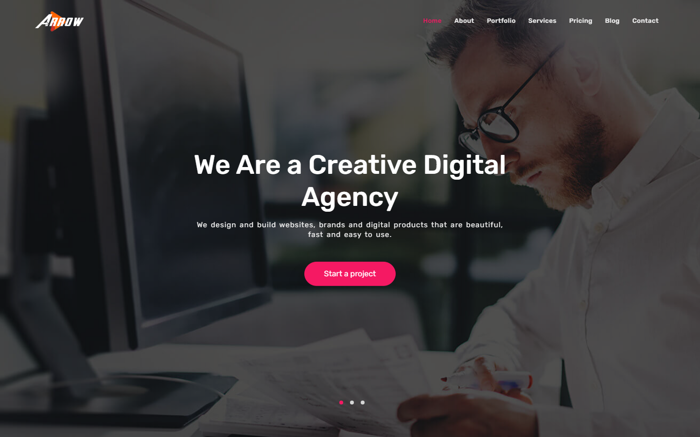
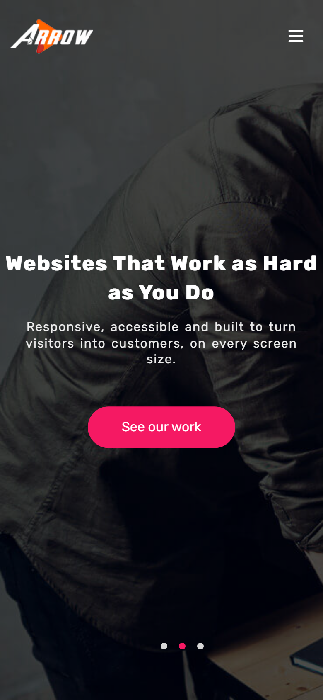

# Arrow: Creative Agency Landing Page

A responsive one-page website for a fictional creative digital agency, built with HTML, SCSS, Bootstrap 5 and jQuery.

**Live demo:** https://asadullahchowdhury.github.io/Arrow/



<p align="center">
  
</p>

## Features

- **Fully responsive.** Works on phones, tablets and desktops, with a collapsible mobile menu that closes after a link is tapped.
- **Sticky header with scrollspy.** The menu highlights the section you're reading.
- **Hero slider** plus testimonial, team and client carousels (Owl Carousel).
- **Filterable portfolio** with a lightbox to view each project.
- **Tabbed services** section.
- **Animated counters** that count up when they scroll into view.
- **Blog posts** that open in a modal.
- **Contact form** with client-side validation and an [AJAX submission to Formspree](#contact-form-setup). The pricing "Order Now" buttons pre-fill the subject line.
- **Accessibility.** Semantic landmarks, a skip link, alt text, labelled form fields and icon buttons, and `prefers-reduced-motion` support.

## Built with

| Tool | Purpose |
| --- | --- |
| HTML5 | Page structure |
| SCSS (Dart Sass) | Styles, split into partials per section (`scss/`) |
| Bootstrap 5.3 | Grid, collapse, tabs, modals |
| jQuery 3.7 | DOM helpers and event handling |
| Owl Carousel 2 | Sliders |
| Animate.css | Hero entrance animations |
| Font Awesome 6 | Icons |

## Project structure

```
├── index.html          # the whole page
├── js/app.js           # scrollspy, counters, lightbox, modals, form, sliders
├── scss/               # source styles
│   ├── style.scss      # entry point
│   ├── variable.scss   # colours
│   ├── global.scss     # shared styles, loader, skip link
│   ├── includes/       # header, footer, buttons
│   └── sections/       # one partial per page section
├── assets/css/         # compiled CSS (generated by npm run build)
└── images/
```

## Running locally

No build step is needed just to view it. Open `index.html` through any local web server, for example:

```bash
npx serve .
```

To change the styles, edit the files in `scss/` and recompile:

```bash
npm install -g sass   # once
npm run build
```

## Contact form setup

The form posts to [Formspree](https://formspree.io), so no backend is required.

1. Create a free form on Formspree and copy its endpoint (for example `https://formspree.io/f/abcdwxyz`).
2. In `index.html`, replace `https://formspree.io/f/YOUR_FORM_ID` in the form's `action` with your endpoint.

Until an endpoint is set, the form validates and shows a "demo" confirmation instead of sending anything.

## Credits

Built as a front-end practice project. The agency, its copy, client names and the people shown are fictional, and the photos are stock images used for demonstration only.

## Author

**Rahat Chowdhury** · [GitHub](https://github.com/asadullahchowdhury)
